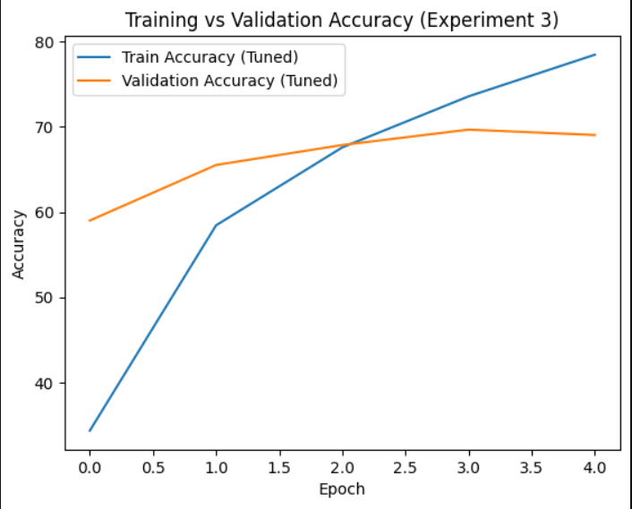
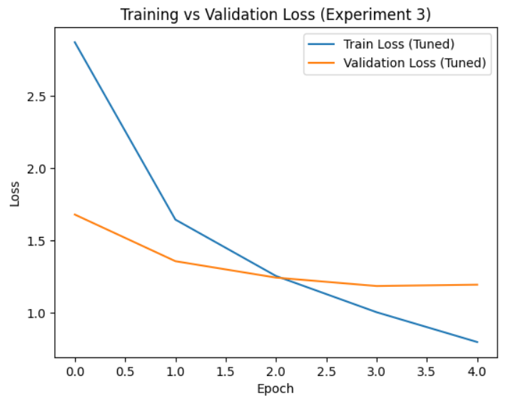

# Food-101 Image Classification: Transfer Learning and Fine-Tuning

Compares three ImageNet-pretrained CNNs (GoogLeNet, MobileNetV3-Small, ResNet18) as frozen feature extractors on Food-101 (101 classes), then fine-tunes the best candidate, ResNet18, by progressively unfreezing layers. Test accuracy improves from 49.9% to 75.1%.

[](https://colab.research.google.com/github/brightysaji/food101-transfer-learning/blob/main/notebooks/01_frozen_backbones.ipynb)

## Results (official 25,250-image test set)

**Part A: frozen backbone + custom MLP head (5 epochs)**

| Model | Test accuracy |
|---|---|
| GoogLeNet | 44.1% |
| MobileNetV3-Small | 49.9% |
| ResNet18 | 49.9% |

**Part B: ResNet18 fine-tuning (5 epochs)**

| Experiment | What changed | Test accuracy |
|---|---|---|
| 1 | Unfreeze `layer4` | 71.1% |
| 2 | Unfreeze `layer3` + `layer4` | 74.2% |
| 3 | Same layers, dropout 0.5, lower learning rate, weight decay | 75.1% |




## Method

- **Data:** Food-101 (750 train and 250 test images per class). The official training set is split 80/20 into train and validation; the official test set is used only for the final numbers.
- **Preprocessing:** resize to 224x224, ImageNet normalisation, random horizontal flip (training only).
- **Part A:** all backbone layers frozen; a new head (three linear layers: 512, 256, 101, with dropout 0.3) is trained with Adam (lr 1e-3), batch size 32.
- **Part B:** ResNet18 with a 512-unit head. Experiments 1-2 use Adam (lr 1e-4). Experiment 3 uses dropout 0.5, lr 5e-5 and weight decay 1e-4.
- **Diagnosis:** training accuracy (about 78-84%) rises well above validation accuracy (about 66-69%), so the models overfit; experiment 3 narrows that gap with regularisation.

## Repository layout

```
notebooks/01_frozen_backbones.ipynb      Part A: three frozen backbones
notebooks/02_fine_tuning_resnet18.ipynb  Part B: progressive unfreezing and tuning
docs/                                    result figures
```

## How to run

1. Open a notebook in Google Colab (GPU runtime) or locally with `pip install -r requirements.txt`.
2. The first cells download Food-101 (about 5 GB) from the official site and extract it to `./data`. The dataset is not included in this repository.

## Limitations

- Single run per experiment, 5 epochs, no random seed set, so exact numbers will vary between runs.
- The validation split is random and is drawn from the augmented training set, so validation images also receive random flips.
- ResNet18 and MobileNetV3-Small are effectively tied in Part A (49.90% vs 49.87%); ResNet18 was chosen for its unfreezing options.
- Experiment 3 changed dropout, learning rate and weight decay together, so the gain cannot be attributed to one change.
- Test accuracy (75.1%) is higher than validation (about 69%). A likely reason is that Food-101's training images contain some noisy labels while the test set was manually cleaned (a hypothesis I have not tested).
- The confusion matrices in the notebooks show only the first 10 of 101 classes, and there are no per-class metrics.

## Possible next steps

Per-class precision/recall/F1 and a list of the most confused classes, Grad-CAM visualisations, a learning-rate schedule with more epochs, and repeated runs with different seeds.

## Data and credit

Bossard, L., Guillaumin, M., Van Gool, L. (2014). *Food-101: Mining Discriminative Components with Random Forests.* ECCV.
Dataset: https://data.vision.ee.ethz.ch/cvl/datasets_extra/food-101/

Code is released under the MIT License.
